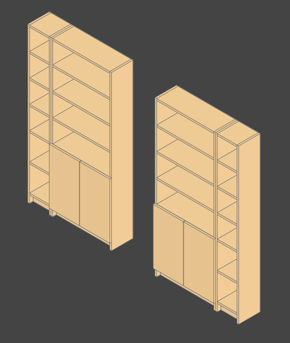
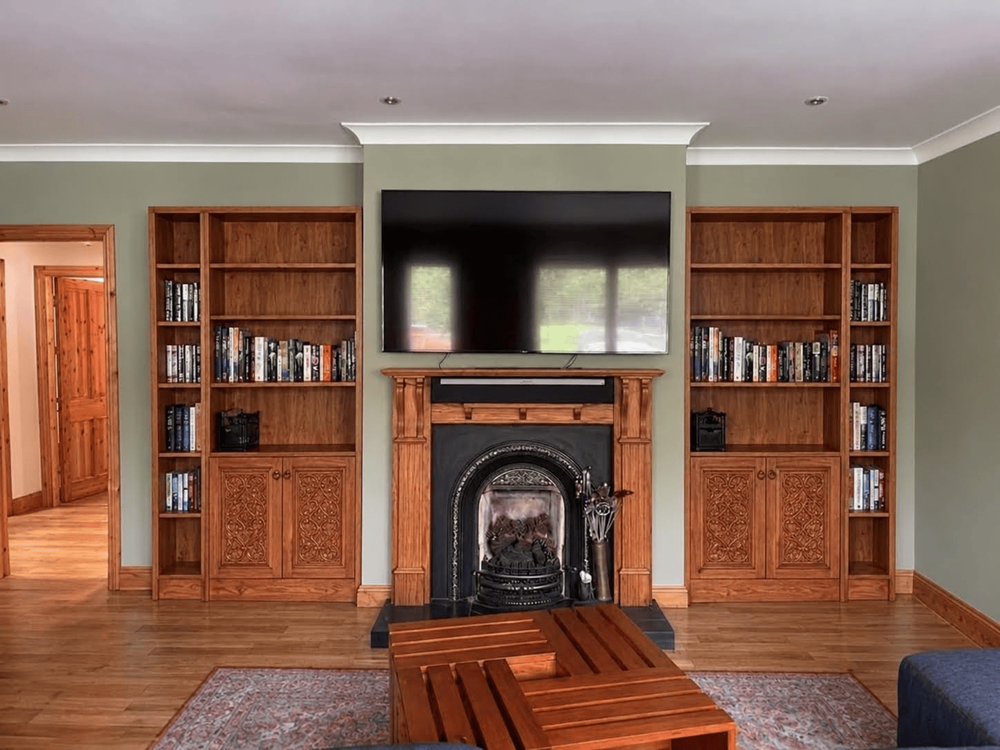

# Bookshelf

Plans for two built-in-style laminated pine bookshelves, one either side of a fireplace.
Each has a narrow open bay and a wide bay with a 2-door cabinet below. One parametric
model generates everything needed to buy, cut and assemble them.



## The design

- Chunky 37mm pine frame, 18mm shelves and doors, black V-groove backs.
- Open shelves lined up across both bays, inset doors flush with the frame.
- Cut at home with a plunge saw from a few full sheets.

The full requirements, design rules and rejected options are in
[`docs/spec.md`](docs/spec.md). Sizes, sheet counts and cost are in
[`build/materials.md`](build/materials.md).

Early concept, with help from Gemini:


## What it produces

Run `just build`; everything lands in `build/`:

| File | What it's for |
| --- | --- |
| [`materials.md`](build/materials.md) | Parts list, sheets to buy, hardware and cost |
| [`instructions.md`](build/instructions.md) | Step-by-step build: cutting list, shelf marking heights, screw positions, squaring, hinges, install |
| `sheets/*.svg`, `all.png` | Cutting diagrams with part labels, sizes and grain direction |
| `front.svg` | Front elevation |
| `bookshelf.step`, `.stl` | 3D model for CAD tools or previews |

Only `materials.md` and `instructions.md` are committed.

## Changing it

Settings live in [`src/bookshelf/settings/`](src/bookshelf/settings): `design.py` for
dimensions and limits, `catalog.py` for sheets and products with prices. Change one, run `just build`, and the
cutting list, cost and instructions follow. The build checks the model and the cutting
layout, and fails loudly if something doesn't fit.

- **Needs:** [uv](https://docs.astral.sh/uv/), [just](https://just.systems/), librsvg
  (`brew install librsvg`).
- **Commands:** `just build`; `just check` for lint, types, spelling and tests;
  `just view` for the
  [OCP CAD Viewer](https://marketplace.visualstudio.com/items?itemName=bernhard-42.ocp-cad-viewer).

## How this app was made

1. Start with image gen: Gemini posting an image of current space and ask it to remove what's currently there. Then ask it for ideas, more ideas, tell it which I like and why, more ideas, …. This took like 1.5 hours of back and forth with Gemini.

2. Refine goals, approaches, constraints, make a fancy plan generator app with Claude Code. 

Starting Prompt:
```txt
goal: help me create an app spec to to make 4 natural wood, quality, simple bookshelves based on 2 designs

Design 1: a 2.5’ wide, 7ft tall, 12” deep, 2 doors lower, 4 compartments above

Design 2: 1ft wide, 7ft tall, 12” deep, 6 compartments

Outputs:

- generate models using the most suitable, ai friendly OSS cad lib
- build instructions
- materials list
- cut guides 
```

...chat for like 4 hours to refining.

And then, only then, did I tell it to actually implement the app
